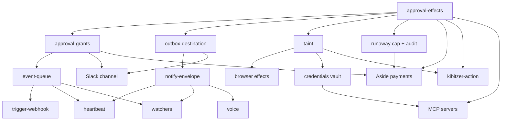

> SUPERSEDED 2026-10-18 by .omo/plans/autonomy-two-axis.md (based on deployed slack worktree; migrations from 0046). Kept for history.

# omon-gateway 자율 에이전트 벤치마킹 구현계획서

- 작성일: 2026-10-17
- 입력:
  - 기존 조사: `docs/research/autonomous-agent-platform-plan.md`, `.omo/ulw-research/20261016-133102-autonomous-agents/`
  - 이번 테마별 판정 리포트: `.omo/ulw-research/20261017-autonomy-benchmark/lanes/*.md` (20개)
- 범위: Instinct, Pickle, OpenAI Dots, Meta Muse, xAI Grok Bot, Hark를 중심으로, OpenClaw·Hermes·Poke·ChatGPT Pulse 등 유사 시스템까지 포함합니다. 이 가운데 omon-gateway가 실제로 가져올 것만 골랐습니다.
- 기준: omon-gateway의 운영 조건은 다음과 같습니다.
  - 오너 한 명이 쓰고, 오너의 Mac에서 상시 가동합니다.
  - Discord가 중심 채널이고, 주요 기능은 cron·inbox·lanes입니다.
  - 모델을 주기적으로 불러 "확인"시키는 폴링은 하지 않습니다.
  - 성공 여부는 기계적으로 판정합니다(종료 코드, 건수, 실제 수신).
  - 결함은 개별 크론 프롬프트가 아니라 게이트웨이 코드에서 고칩니다.
  - KST 0~8시에는 알림을 보내지 않습니다.
- 표기:
  - `path:line`은 지금 존재하는 코드이며, 2026-10-17에 줄 단위로 대조했습니다.
  - `(신규)`는 새로 만들 파일이라 줄 번호가 없습니다.

---

## 1. 결론 요약

경쟁 플랫폼의 사고(Grok Bot Slack 오발송, Instinct 이메일 prompt injection, Muse 무승인 구매 수락)는 모두 같은 원인에서 나왔습니다. **결정론적 경계 없이 자율성부터 켰기 때문입니다.** 그래서 벤치마킹 우선순위는 "안전 경계 → 이벤트 기반 선제성 → 채널 확장" 순입니다.

1. **승인 엔진(effect 분류 + 지속형 승인)** — 지금은 agent turn의 도구 요청이 사실상 전부 자동 승인됩니다(`src/agent/omo_backend.rs:1459-1471`). lane에서 승인이 필요하면 작업이 그대로 실패합니다(`src/lanes/runner.rs:661-664`). 무인 운영의 전제 조건입니다. (Dots·Muse·Hark)
2. **목적지 고정 + outbox** — cron 수신처는 JSON 문자열을 그대로 해석합니다(`src/cron/scheduler.rs:2535`). 불변 ID 레지스트리와 발송 전 draft를 둡니다. (Grok Bot 사고 대응)
3. **taint 추적** — inbox(메일·카카오·iMessage·Discord)에서 들어온 신뢰할 수 없는 입력이 상태 변경이나 외부 발송으로 바로 이어지지 않게 막습니다. (Muse의 tainted egress, Instinct 사고)
4. **비중단 이벤트 큐** — lead 세션이 바쁘면 시스템 이벤트를 버립니다(`src/multiplexer/actor.rs:360-364`). 이 이벤트를 큐에 보존하고, 오너 메시지만 진행 중인 작업을 끊게 합니다. (Grok Bot)
5. **외부 webhook 트리거** — 시간 외의 외부 사건(GitHub, CI, 모니터링)에 모델 비용 없이 반응하는 유일한 입구입니다. (Grok Bot webhooks, Standard Webhooks)
6. **heartbeat + 통합 알림 envelope** — 모델을 부르기 전에 skip 여부를 판정하고(OpenClaw/Hermes), notify·question·review 세 타입과 억제 원장을 둡니다(Muse, Pulse). 오너의 "의미 있을 때만, 밤에는 침묵" 원칙을 코드로 강제합니다.
7. **Slack 양방향 채널 + Instinct식 watcher** — Slack 연동은 오너가 이미 요청했습니다. watcher는 Instinct에서 유일하게 가져올 가치가 있는 부분입니다.
8. **음성(음성 답장 + 실시간 음성)과 Aside 결제** — 오너 결정(2026-10-17)으로 채택했습니다. 결제 카드나 결제 수단 API는 직접 다루지 않습니다. 이미 로그인된 오너의 Aside 브라우저가 결제를 실행하고, 게이트웨이는 결제마다 확인받기와 영수증 기록만 맡습니다(금액 한도 없음).

---

## 2. 벤치마킹 판정표

| 테마 | 판정 | 원천 플랫폼 | 오너 가치 근거 | 현재 코드 위치 | 단계 |
|---|---|---|---|---|---|
| approval-effects (effect 분류·결정 엔진) | 채택 | Dots(4상태 + Auto-review), Muse Sentinel, Hark ask/standing | 무인 lane·cron이 호스트를 바꾸거나 외부로 발송하는 일을 결정론적으로 차단 | `src/agent/omo_backend.rs:1459-1471` | B0 |
| approval-grants (지속형 승인 원장) | 채택 | Muse 5단계 범위, Dots hand-off | 승인을 기다리는 동안 작업을 보존하고, 오너가 깨어난 뒤 승인 | `src/discord/approval.rs:580`, `migrations/0007_approval_allowlist.sql:1-4`, `src/lanes/runner.rs:661-664` | B0 |
| outbox-destination (목적지 고정·draft) | 채택 | Grok Bot Slack 사고(반면교사) | 오발송·유출 방지, 이름이 겹치면 fail-closed | `src/cron/scheduler.rs:2535-2545` | B0 |
| taint (신뢰 불가 입력 추적) | 채택 | Muse tainted egress, Rule of Two, Instinct 사고 | inbox 기반 prompt injection 차단 | `src/security/neutralize.rs:38-45`, `migrations/0034_inbox.sql:1-6` | B0 |
| usage-ledger (폭주 상한·행동 감사) | 채택(한정) | Dots 일 307k 토큰, Grok Bot 10분 $50 | 토큰 통계는 제외(오너 지시)하고, 폭주 차단과 외부 영향 감사만 함 | `migrations/0039_model_usage.sql:1-17`, `src/usage.rs:189-192` | B0 |
| event-queue (비중단 큐·오너 interrupt) | 채택 | Grok Bot queue/interrupt/step log | cron·lane 결과 유실 해소, 크래시 후 재개 | `src/multiplexer/actor.rs:360-364` | B1 |
| trigger-webhook (외부 이벤트 트리거) | 채택 | Grok Bot webhooks, Dots 이벤트 트리거 | 모델 비용 0으로 외부 사건에 반응하는 이벤트 기반 구조 | `src/dashboard.rs:742-750` | B1 |
| heartbeat (사전 skip 게이트) | 채택 | OpenClaw heartbeat, Hermes fire accounting | 할 일이 없으면 모델을 부르지 않고 침묵 | `src/work_heartbeat.rs:14-20`, `src/cron/scheduler.rs:233`, `src/cron/executor.rs:659-665` | B1 |
| notify-envelope (알림 envelope·salience) | 채택 | Muse salience gate, ChatGPT Pulse, Poke | 알림 피로 차단, 억제한 알림을 원장에 기록 | `src/cron/scheduler.rs:233` | B1 |
| channels (Slack 양방향) | 채택 | Dots/Grok Bot Slack, Instinct 다채널 | 오너가 Discord와 같은 수준의 Slack 연동을 요청함(T04LYPT5VN1) | `src/cron/scheduler.rs:2535-2545` | B2 |
| instinct-focus: watchers/follow-ups | 채택 | Instinct watcher·follow-up | 이벤트 기반 상태 감시, KST 침묵 가드 | `src/inbox/watchers.rs:12-18`, `src/lanes/kibitzer.rs:21-25` | B2 |
| browser-agent (오너 실제 브라우저 연동) | 채택(한정) | Instinct cloud computer, Pickle Kernel, Dots cloud PC(반면교사) | 클라우드 브라우저 대신 오너의 로그인된 브라우저(CDP)를 쓰고, effect·taint 게이트를 통과시킴 | `src/tools/browser.rs:22-30` | B2 |
| credentials (Keychain vault·대리 토큰) | 채택(한정) | Muse surrogate token, Pickle `forward` | 에이전트가 비밀을 평문으로 보지 않게 함. 클라우드 enclave는 제외 | (근거는 lanes/credentials.md) | B3 |
| kibitzer-action (제안 → 실행) | 보류 | Hark proactive, Muse Goals | B0 승인 엔진과 읽기 전용 실행 프로필이 생긴 뒤에 함 | `src/lanes/kibitzer.rs:21-25` | B3 |
| mcp-connectors (MCP 서버 등록) | 보류 | Dots 4,000개 이상 앱, Grok Bot custom MCP | MCP 클라이언트 구현은 있지만 등록 목록이 비어 있음. 정책 엔진 이후에 연결 | `src/main.rs:1082`, `src/tools/mcp.rs:18-28`, `src/tools/mcp.rs:213-221` | B3 |
| memory-facts (owner 범위 사실 메모리) | 보류 | Muse claims, Grok Bot 4계층 | 오너는 이미 omo 메모리 저장소(system/human.md 주입)를 씀. 게이트웨이 메모리는 세션 단위임 | `src/memory/store.rs:35-40` | B3 |
| memory-dream (야간 정리·diff 제안) | 보류 | Muse dream, Hark forget | memory-facts가 먼저 필요함 | `src/memory/store.rs:35-40` | 이후 |
| voice (음성 답장·실시간 음성) | 채택 | Pickle 음성, Instinct 전화, Hark | 오너 결정으로 채택. Songbird 의존성과 수신 리스너는 이미 있고 연결만 안 되어 있음 | `src/voice/mod.rs:14-24`, `src/discord/adapter.rs:1688-1693`, `src/discord/adapter.rs:2218-2219` | B2 |
| payments (Aside 결제 실행) | 채택 | Pickle 카드 확인, Hark 결제 카드, Muse Link | 오너 결정: 결제는 로그인된 Aside 브라우저가 실행하고, 게이트웨이는 결제마다 확인받기와 영수증 기록만 담당(금액 한도 없음) | `src/tools/browser.rs:22-30` | B2 |
| sandbox (실행 격리) | 보류 | 전 플랫폼 VM·microVM | iMessage TCC/FDA와 로컬 작업트리가 호스트에 묶여 있음. seatbelt 부분 격리부터 B3 이후 검토 | (근거는 lanes/sandbox.md) | 이후 |
| a2a (에이전트 간 통신) | 보류 | A2A 프로토콜 | 오너 한 명이 쓰는 환경이라 상대 에이전트가 없음. 수요가 생기면 다시 판정 | — | 이후 |
| instinct-focus: 지속형 cloud PC | 제외 | Instinct | 오너의 Mac이 이미 상시 가동 중이고 주거용 IP·로그인 세션을 갖고 있음 | — | — |
| instinct-focus: 전용 전화번호 | 제외 | Instinct | Discord·iMessage로 충분하고, A2A/SMS 규제 비용만 생김 | — | — |
| instinct-focus: 다채널 단일 스레드 | 제외 | Instinct | "채널·스레드마다 전용 세션 고정" 원칙과 충돌함 | — | — |
| instinct-focus: 비밀번호 위탁 vault | 제외(대체) | Instinct | 평문 위탁 대신 B3의 credentials(대리 토큰)로 대체 | — | — |

memory-facts 판정은 재작성된 리포트(`lanes/memory-facts.md`)와 일치합니다(보류). 오너의 선호·규칙은 이미 omo 메모리 저장소의 `system/human.md`로 매 세션에 주입되고 있습니다. 게이트웨이에 bi-temporal 사실 추출을 넣으면 메시지마다 LLM 비용이 들고, 두 메모리 계층이 서로 어긋날(split-brain) 위험이 생깁니다.

---

## 3. 단계별 구현 계획

공통 규칙:
- 새 동작은 모두 env kill switch를 두고 기본값은 off입니다. 이름은 기존 관례인 `OMON_*_ENABLED`(예: `OMON_LANES_ENABLED`, `src/main.rs:905`)를 따릅니다.
- 단계마다 PR 하나로 배포합니다. 검증은 CLI 출력, SQLite 상태, 로그 줄 같은 기계 판독 결과로 하고, Discord 실제 수신 확인은 오너가 직접 합니다.
- 배포는 `scripts/deploy.sh`로만 합니다(Developer ID 서명).

### 마이그레이션 번호 배정

현재 마지막 migration은 `migrations/0044_tracker.sql`입니다. 판정 리포트들은 서로 같은 번호(0045 등)를 제안했으므로 아래 번호로 확정합니다.

| 번호 | 파일 | 단계 | 테마 |
|---|---|---|---|
| 0045 | `migrations/0045_approval_effects.sql` (신규) | B0 | approval-effects, approval-grants (`approval_requests`, `approval_grants`) |
| 0046 | `migrations/0046_destinations_outbox.sql` (신규) | B0 | outbox-destination (`destinations`, `outbox`) |
| 0047 | `migrations/0047_taint.sql` (신규) | B0 | taint (`lanes.taint` 열, `lane_profiles`) |
| 0048 | `migrations/0048_action_audit.sql` (신규) | B0 | usage-ledger (`action_audit`, lane별 상한) |
| 0049 | `migrations/0049_event_queue.sql` (신규) | B1 | event-queue (`pending_events`) |
| 0050 | `migrations/0050_triggers.sql` (신규) | B1 | trigger-webhook (`triggers`, `trigger_events`) |
| 0051 | `migrations/0051_heartbeats.sql` (신규) | B1 | heartbeat (`agent_heartbeats`) |
| 0052 | `migrations/0052_notification_envelopes.sql` (신규) | B1 | notify-envelope (`notifications`, `notification_suppressions`) |
| 0053 | `migrations/0053_channel_identities.sql` (신규) | B2 | channels (플랫폼 중립 대상 ID) |
| 0054 | `migrations/0054_watchers.sql` (신규) | B2 | watchers (`watchers`, `watcher_runs`) |
| 0055 | `migrations/0055_spend_ledger.sql` (신규) | B2 | payments (`spend_leases`, `spend_events`) |
| 0056 | `migrations/0056_credentials_vault.sql` (신규) | B3 | credentials (`credential_handles`, 감사 체인) |
| 0057 | `migrations/0057_mcp_servers.sql` (신규) | B3 | mcp-connectors |

### B0. 안전 기반 (규모 L)

목표: 무인 실행이 호스트를 바꾸거나 외부로 내보내거나 돈을 쓰는 동작은 반드시 정책을 통과하게 합니다. 이 단계 전에는 B1 이후의 자율 기능을 켜지 않습니다.

1. **effect 분류·정책 엔진** (approval-effects)
   - 신규 파일:
     - `src/policy/mod.rs` (신규)
     - `src/policy/effect.rs` (신규) — effect 6종: `Read`, `Draft`, `Write`, `SendExternal`, `Spend`, `Irreversible`
     - `src/policy/decision.rs` (신규) — 결정 4종: `Allow`, `Ask`, `HandOff`, `Deny`
   - 연결 지점: `src/agent/omo_backend.rs:1459-1471`의 `auto_approve` 분기를 정책 엔진 호출로 바꿉니다. 판정 리포트가 정리한 omo 승인 요청 구조는 `src/agent/omo_protocol.rs:122-149`에 있습니다.
   - kill switch: `OMON_APPROVAL_EFFECTS_ENABLED`. off이면 기존 동작을 그대로 유지합니다.
   - 검증:
     - effect별 판정 표를 단위 테스트로 고정합니다.
     - 로그에 `policy decision effect=Write decision=Ask`가 찍히는지 확인합니다.
     - `sqlite3 ~/.omon/omon.db "select count(*) from approval_requests where status='pending'"`의 값이 늘어나는지 확인합니다.
2. **지속형 승인 원장** (approval-grants)
   - migration 0045를 추가합니다. 승인은 action payload hash에 묶고, 범위는 `Once`, `Task`, `Until`, `Standing` 중 하나입니다. 기존 `approval_allowlist`(`migrations/0007_approval_allowlist.sql:1-4`)에는 TTL도 주체도 없으므로 이관합니다.
   - lane에서 승인이 필요할 때는 에러 대신 `Blocked` 상태로 멈추고 요청을 저장합니다(`src/lanes/runner.rs:661-664`를 교체).
   - 승인 UI는 Discord 버튼을 재사용하되, 메모리에만 있는 pending 맵(`src/discord/approval.rs:580`)을 DB 원장으로 바꿉니다.
   - 응답이 없으면 deny로 처리합니다. KST 0~8시에는 요청 알림을 모았다가 08시에 한 번 보냅니다.
   - kill switch: `OMON_PERSISTENT_APPROVALS_ENABLED`.
   - 검증:
     - 승인 대기 중에 게이트웨이를 재시작해도 행이 보존되는지 SQL로 확인합니다.
     - 승인 후 lane 상태가 `Blocked`에서 실행 상태로 바뀌는지 `omon lanes list` 출력으로 확인합니다.
3. **목적지 고정 + outbox** (outbox-destination)
   - 신규 파일: `src/outbox/mod.rs` (신규), migration 0046.
   - cron 수신처 해석(`src/cron/scheduler.rs:2535-2545`)을 `destinations` 레지스트리 조회로 바꿉니다. 이름이 여러 대상과 겹치면 발송하지 않습니다(fail-closed).
   - `SendExternal` effect는 먼저 outbox에 draft로 넣고, 정책이 `Allow`일 때만 내보냅니다.
   - kill switch: `OMON_DESTINATION_BINDING_ENABLED`, `OMON_OUTBOX_ENABLED`.
   - 검증:
     - 대상 이름이 겹치는 fixture로 발송하면 거부되고 `outbox.status='blocked_ambiguous'`가 남는지 확인합니다.
     - 정상 cron 1건이 `sent`로 바뀌는지 확인합니다.
4. **taint** (taint)
   - 신규 파일: `src/security/taint.rs` (신규), migration 0047.
   - inbox 항목(source가 mail·kakao·discord·imessage, `migrations/0034_inbox.sql:3`)을 읽은 lane이나 세션에는 taint를 붙입니다.
   - taint가 붙은 세션의 `SendExternal`·`Write`·`Spend`는 자동 허용 대상에서 빠지고 `Ask`로 올라갑니다. Rule of Two 원칙(신뢰 불가 입력, 민감 데이터, 상태 변경 세 가지가 한 세션에 동시에 있으면 안 됨)을 적용한 것입니다.
   - 기존 문자열 정리 함수(`src/security/neutralize.rs:38-45`)는 그대로 둡니다. 정리는 문자열 수준이고 taint는 실행 권한 수준이라 역할이 다릅니다.
   - kill switch: `OMON_TAINT_TRACKING_ENABLED`, `OMON_TAINT_EGRESS_GATE_ENABLED`.
   - 검증: 주입 문구가 들어간 inbox fixture로 lane을 실행했을 때 외부 발송 시도가 `decision=Ask reason=tainted`로 기록되는지 확인합니다.
5. **폭주 상한·행동 감사** (usage-ledger, 한정 채택)
   - `model_usage` 테이블(`migrations/0039_model_usage.sql:1-17`)은 존재하지만 코드에서 `INSERT INTO model_usage`를 하는 곳이 없습니다(rg 결과 0건).
   - 토큰 통계 리포트는 만들지 않습니다(오너 지시). 대신 lane·세션별 turn 수와 비용 상한만 셉니다. 상한을 넘으면 lane을 `Blocked`로 멈추고 알림을 1회 보냅니다.
   - 외부 영향이 있는 행동(`SendExternal`, `Write`, `Spend`)은 실행 전에 `action_audit`에 먼저 기록합니다.
   - kill switch: `OMON_RUNAWAY_CAP_ENABLED`, `OMON_ACTION_AUDIT_ENABLED`.
   - 검증: 상한을 낮게 잡은 fixture lane이 상한 지점에서 멈추고 `action_audit` 행 수가 기대값과 같은지 확인합니다.

### B1. 이벤트 기반 선제성 (규모 M~L, B0 이후)

1. **비중단 이벤트 큐** (event-queue)
   - lead 세션이 바쁠 때 시스템 이벤트를 `"lead session is busy"`로 거부하는 분기(`src/multiplexer/actor.rs:360-364`)를 바꿉니다. 대신 `pending_events`(migration 0049)에 넣고, 턴이 끝나면 순서대로 꺼내 처리합니다.
   - 진행 중인 작업을 끊는 것은 오너 메시지만 할 수 있습니다. cron·inbox·lane 결과는 큐에 쌓입니다.
   - 저장소는 `src/storage/event_queue.rs` (신규)입니다.
   - kill switch: `OMON_EVENT_QUEUE_ENABLED`.
   - 검증:
     - 바쁜 상태에서 시스템 이벤트 3건을 주입하면 `pending_events`에 3행이 남는지 확인합니다.
     - 턴이 끝난 뒤 0행이 되고, 로그의 처리 순서가 주입 순서와 같은지 확인합니다.
     - 게이트웨이를 재시작한 뒤에도 남은 행이 처리되는지 확인합니다.
2. **외부 webhook 트리거** (trigger-webhook)
   - 기존 axum 라우터(`src/dashboard.rs:742-750`)에 `POST /api/triggers/{id}`를 추가합니다.
   - 수신 규칙은 Standard Webhooks를 따릅니다: HMAC-SHA256 서명 검증, 5분 replay window, 본문 1MiB 상한, `202 Accepted`. 받은 이벤트는 `trigger_events`에 넣고 webhook id로 중복을 걸러 B1-1 큐로 보냅니다.
   - 대시보드는 loopback에서만 열려 있으므로, 외부에서 받으려면 오너가 Tailscale 등으로 노출을 직접 결정해야 합니다(7장 참조).
   - kill switch: `OMON_TRIGGER_WEBHOOK_ENABLED`.
   - 검증:
     - `curl -i -X POST localhost:<port>/api/triggers/t1 -H 'webhook-signature: v1,<good>' ...` → `202`
     - 서명이 틀린 요청 → `401`
     - 같은 webhook-id 재전송 → `trigger_events` 행 수 변동 없음
3. **heartbeat** (heartbeat)
   - 기존 `src/work_heartbeat.rs:14-20`은 멈춘 작업을 감지하는 용도이므로 그대로 둡니다. 새 heartbeat는 cron 작업 한 종류로 붙입니다(migration 0051).
   - 모델을 부르기 전에 skip 사유를 판정합니다: disabled, outside-hours(KST 0~8), empty-scratch, busy, no-route, channel-not-ready.
   - 응답이 침묵 토큰이면 발송하지 않습니다. 이 동작은 기존 장치를 재사용합니다: 침묵 토큰 목록 `src/cron/scheduler.rs:233`, 발송 생략 경로 `src/cron/executor.rs:659-665`.
   - 발화는 먼저 기록하고, 러너가 시작되지 않으면 기록을 되돌립니다(Hermes 방식).
   - kill switch: `OMON_HEARTBEAT_ENABLED`.
   - 검증: 빈 scratch 상태에서 1주기를 돌렸을 때 로그가 `heartbeat skip reason=empty-scratch`이고, 모델 호출이 0회이며(app-server 요청 로그 0건), 발송도 0건인지 확인합니다.
4. **알림 envelope·salience** (notify-envelope)
   - `notify`, `question`, `review` 세 타입의 envelope을 두고(migration 0052), cron·세션 감시·lane 완료 알림이 모두 이 envelope을 거치게 합니다.
   - salience gate에 걸린 알림과 KST 0~8시 알림은 버리지 않고 `notification_suppressions`에 기록합니다. 08시에 묶어서 1회 보냅니다.
   - kill switch: `OMON_NOTIFY_ENVELOPE_ENABLED`, `OMON_SALIENCE_GATE_ENABLED`.
   - 검증: KST 02시로 시각을 고정한 테스트에서 발송 0건, 억제 원장 1행이 남는지 확인합니다.

### B2. 채널과 감시 (규모 M~L, B0 이후, B1과 병행 가능)

1. **Slack 양방향 채널** (channels)
   - 플랫폼 중립 대상 ID를 도입합니다(migration 0053). cron 수신처는 지금 Discord 전용으로 해석되므로(`src/cron/scheduler.rs:2535-2545`) `destinations` 레지스트리로 일반화합니다.
   - 신규 파일:
     - `src/slack/mod.rs` (신규) — Socket Mode 수신, Web API 발신
     - `src/channels/router.rs` (신규) — 플랫폼별 발신 라우터
   - Discord와 같은 수준으로 맞출 범위: 채널·스레드마다 전용 세션 고정, 승인 버튼, 스레드 답변.
   - kill switch: `OMON_SLACK_ENABLED`.
   - 검증: `omon` CLI로 Slack 테스트 채널에 발신했을 때 API 응답이 `ok=true`인지 확인합니다. 실제 수신 확인은 오너가 합니다.
2. **watcher·follow-up** (Instinct에서 유일하게 채택)
   - 기존 inbox watcher 이벤트(`src/inbox/watchers.rs:12-18`)와 kibitzer 간격·KST 상수(`src/lanes/kibitzer.rs:21-25`)를 재사용합니다. 그 위에 "조건이 될 때까지 감시하고, 되면 한 번 알린다"는 watcher 객체를 둡니다(migration 0054). 각 watcher에는 TTL, 토큰 버킷, KST 침묵 가드가 있습니다.
   - 확인은 모델 없는 로컬 체크(스크립트 종료 코드나 SQL)로 합니다. 조건이 충족될 때만 모델을 부릅니다.
   - kill switch: `OMON_WATCHERS_ENABLED`.
   - 검증: 조건 스크립트가 처음으로 exit 0을 반환했을 때만 `watcher_runs.fired=1` 행이 1개 생기는지, 그 이전의 체크는 모델 호출 0회인지 확인합니다.
3. **오너 브라우저 연동** (browser-agent, 한정 채택)
   - 기존 CDP 브라우저 도구(`src/tools/browser.rs:22-30`)에 B0의 effect 분류를 붙입니다. 클릭·제출은 `Write`나 `SendExternal`, 결제 페이지는 `Spend`로 분류합니다. 브라우저로 읽은 페이지에는 taint를 붙입니다.
   - kill switch: `OMON_BROWSER_ACTIONS_ENABLED`.
   - 검증: taint가 붙은 세션에서 폼 제출을 시도하면 `decision=Ask`로 기록되는지 확인합니다.
4. **Aside 결제** (payments, 오너 결정으로 채택)
   - 구조: 결제는 오너의 로그인된 Aside 브라우저가 실행합니다(`aside exec` 또는 `aside repl --account u0`). 게이트웨이는 카드 번호나 결제 API 키를 다루지 않습니다.
   - 게이트웨이가 맡는 것:
     - 결제 승인 기록: 오너가 확인한 가맹점·금액·장바구니를 묶은 1회용 승인입니다. migration 0055의 `spend_leases`·`spend_events`, 신규 파일 `src/spend/mod.rs` (신규).
     - 승인: B0 정책 엔진의 `Spend` effect입니다. 결제는 금액과 무관하게 항상 `Ask`로 오너에게 묻습니다. 승인 카드에는 가맹점, 금액, 장바구니 요약을 보여 줍니다.
     - 금액 일치 확인: 금액 한도는 두지 않습니다(오너 결정: 결제마다 확인받으면 충분). 대신 결제 직전 최종 금액이나 가맹점이 확인받은 내용과 다르면 결제를 중단하고 다시 묻습니다. 배송비·세금이 붙어 금액이 바뀌는 경우가 여기에 해당합니다.
     - 영수증: Aside 실행이 끝나면 주문번호와 금액을 `spend_events`에 기록합니다. 성공 판정은 Aside의 설명 문장이 아니라 주문 확인 페이지에서 추출한 주문번호로 합니다.
   - 실행 경로: 결제 lane이 승인된 lease ID를 넘겨 Aside를 서브프로세스로 실행합니다. 지금은 aside를 직접 실행하는 Rust 코드가 없습니다(판정 리포트의 전수 검색 결과). 기존 CDP 도구(`src/tools/browser.rs:22-30`)와는 별도로 `src/tools/aside.rs` (신규)를 둡니다.
   - Aside 세션이 만료되면 결제를 실패로 끝내고 오너에게 재로그인을 요청합니다(자동 재시도 없음).
   - kill switch: `OMON_PAYMENTS_ENABLED`.
   - 검증:
     - 승인 없이 결제 lane을 시작하면 `spend_leases.state='awaiting_approval'` 상태로 멈추는지 확인합니다.
     - 확인받은 금액과 다른 최종 금액 fixture는 결제하지 않고 `state='aborted_amount_changed'`로 끝나며 재확인 요청이 1건 생기는지 확인합니다.
     - 성공 시 `spend_events`에 주문번호(`receipt_ref`)가 비어 있지 않은 행이 1개 생기는지 확인합니다.
5. **음성** (voice, 오너 결정으로 채택)
   - 현재 상태:
     - 음성 메시지 수신과 전사(STT)는 운영 중입니다(`src/discord/adapter.rs:1688-1693`).
     - Discord 음성 메시지 메타데이터 생성 함수가 있습니다(`src/discord/adapter.rs:2218-2219`).
     - Songbird 의존성과 실시간 수신 리스너(`src/voice/mod.rs:14-24`)도 이미 있지만, 실제로 붙이는 코드가 없습니다.
   - 단계 1, 음성 답장(TTS): `src/voice/tts.rs` (신규)를 둡니다. 오너가 음성으로 말하면 답도 음성 메시지로 보냅니다. B1 알림 envelope를 거치므로 KST 0~8시에는 보내지 않습니다. kill switch: `OMON_VOICE_TTS_ENABLED`.
   - 단계 2, 실시간 음성 채널: Songbird 리스너를 Discord 음성 채널에 연결해 실시간으로 듣고 말합니다. 오너가 음성 채널에 들어왔을 때만 붙고, 나가면 해제합니다. kill switch: `OMON_VOICE_SONGBIRD_ENABLED`.
   - 검증:
     - TTS 단위 테스트가 Discord 음성 메시지 형식(ogg, 메타데이터 포함) 파일을 만드는지 확인합니다.
     - 실시간 연결은 게이트웨이 로그 `songbird listener attached channel=<id>`와 연결 해제 로그가 쌍으로 남는지 확인합니다. 실제 음성 품질은 오너가 확인합니다.

### B3. 자격증명·커넥터·메모리 (규모 L, B0~B2 이후)

이 단계의 항목들은 하지 않는 것이 아니라 **순서상 뒤로 둔 것**입니다. 이유는 다음과 같습니다.
- **kibitzer 자동 실행**: kibitzer가 lane을 스스로 시작하게 하려면, 시작된 lane이 무엇을 할 수 있는지가 먼저 정해져 있어야 합니다. 지금은 도구 요청이 자동 승인되므로(`src/agent/omo_backend.rs:1459-1471`), 자동 시작 lane이 파일 수정이나 외부 발송까지 할 수 있습니다. B0 정책 엔진이 생기면 "읽기·초안만 허용" 프로필로 바로 켤 수 있습니다.
- **MCP**: 클라이언트는 이미 구현돼 있어서 서버를 등록하는 것 자체는 작은 작업입니다(`src/main.rs:1082`). 다만 외부 MCP 도구는 게이트웨이가 내용을 모르는 도구입니다. effect 분류와 자격증명 격리(B3-1) 없이 연결하면 승인 우회 경로가 됩니다.
- **사실 메모리**: 오너의 선호와 규칙은 이미 omo 메모리 저장소(`system/human.md`)로 매 세션에 주입되고 있습니다. 게이트웨이에 같은 역할의 저장소를 하나 더 만들면 둘이 서로 어긋날 수 있고, 메시지마다 사실 추출용 LLM 비용도 듭니다. 그래서 게이트웨이만 아는 사실(inbox 인물, 일정)로 범위를 좁혀 B3에서 다시 판정합니다.

먼저 쓰고 싶은 항목이 있으면 B0 완료 직후 B1·B2와 병행해 앞당길 수 있습니다. 의존하는 것은 B0뿐입니다.

1. **credentials**:
   - macOS Keychain을 쓰는 vault를 둡니다: `src/vault/mod.rs` (신규), migration 0056.
   - 에이전트에게는 비밀 대신 handle만 줍니다. 진짜 값은 egress 프록시(`src/egress/mod.rs` (신규))가 요청 host와 path를 매칭해 주입합니다.
   - kill switch: `OMON_CREDENTIALS_VAULT_ENABLED`, `OMON_EGRESS_PROXY_ENABLED`.
2. **kibitzer-action**: kibitzer가 읽기 전용 lane만 스스로 시작할 수 있게 합니다(`src/lanes/kibitzer.rs:21-25`). B0의 정책 엔진이 `Read`·`Draft`만 허용하는 프로필로 실행합니다. kill switch: `OMON_KIBITZER_ACTION_ENABLED`.
3. **mcp-connectors**:
   - MCP 클라이언트 구현(`src/tools/mcp.rs:18-28`, `src/tools/mcp.rs:213-221`)은 있지만, 등록이 `McpTool::default()`로 비어 있습니다(`src/main.rs:1082`).
   - 설정 파일로 서버를 등록하게 하고(migration 0057), 모든 MCP 도구 호출이 정책 엔진을 거치게 합니다.
   - kill switch: `OMON_MCP_ENABLED`.
4. **memory-facts**: 게이트웨이 메모리는 세션 단위입니다(`src/memory/store.rs:35-40`). omo 메모리 저장소와 겹치지 않도록, 게이트웨이가 직접 수집한 사실(inbox 인물, 일정 등)에만 owner 범위 `facts`를 두는 방안을 B3에서 다시 판정합니다.

---

## 4. 의존성 그래프

규칙: 자율성을 넓히는 항목(트리거, heartbeat, watcher, kibitzer-action)은 B0의 승인·taint·상한이 켜진 뒤에만 켭니다.

---

## 5. 보류·제외 항목과 이유

- **보류**
  - **sandbox (VM·컨테이너 전면 격리)**: iMessage 읽기에는 TCC/FDA 권한이 필요하고, 로컬 작업트리에 즉시 반영해야 하는 작업도 있어 호스트에 묶여 있습니다. 전면 격리는 핵심 기능을 깨뜨립니다. B0 이후에 terminal 도구만 seatbelt로 부분 격리하는 방안을 재검토합니다.
  - **a2a (에이전트 간 통신)**: 상대 에이전트가 없는 단일 오너 환경입니다. 결제는 B2-4(Aside 결제)로 채택했습니다.
  - **전화번호 기반 음성 통화**: 음성은 Discord 음성 메시지와 음성 채널로 채택했고, 전화망 연동은 제외합니다.
  - **memory-dream**: 정리할 대상인 facts 계층이 먼저 있어야 합니다.
  - **kibitzer-action, mcp-connectors, memory-facts**: B3에서 다룹니다. 이유는 판정표에 있습니다.
- **제외**
  - **Instinct 지속형 cloud PC·전용 전화번호·다채널 단일 스레드·비밀번호 위탁**: 오너의 Mac 상시 가동 환경과 "채널마다 전용 세션" 원칙에 맞지 않습니다. 비밀번호 위탁은 B3 credentials로 대체합니다.
  - **클라우드 하드웨어 격리(Nitro Enclave 등)**: 오너 한 명이 쓰는 로컬 Mac 환경에는 맞지 않습니다.

---

## 6. 이전 계획서 대비 정정

`docs/research/autonomous-agent-platform-plan.md`와 비교해 이번 대조에서 확인한 내용입니다.

- **승인 자동 허용 위치**: `src/agent/omo_backend.rs:1456-1470` → 실제 분기는 `src/agent/omo_backend.rs:1459-1471`입니다(1456-1458은 주석). 내용은 같습니다. `APPROVAL_MODE=always`가 아니면 전부 자동 허용합니다.
- **heartbeat 신설 방식**: 이전 계획은 별도 job kind를 새로 만들자고 했습니다. 그런데 cron에 이미 침묵 토큰(`src/cron/scheduler.rs:233`)과 무응답 발송 생략(`src/cron/executor.rs:659-665`)이 있습니다. 따라서 새 서브시스템이 아니라 cron 작업 한 종류로 얹는 것이 맞습니다.
- **MCP 상태**: 이전 계획은 MCP가 "없음"이라고 했지만, 클라이언트 구현(stdio·SSE 전송, `src/tools/mcp.rs:18-28`)은 이미 있습니다. 비어 있는 것은 등록 목록(`src/main.rs:1082`)뿐입니다.
- **model_usage**: 테이블은 있고(`migrations/0039_model_usage.sql:1-17`) 이를 기록하는 코드는 여전히 0건입니다(이전 기술과 같음). 다만 이번 계획은 토큰 통계가 아니라 폭주 상한과 행동 감사만 채택합니다.
- **migration 번호**: 이전 계획은 번호를 정하지 않았고, 판정 리포트들은 0045를 중복 제안했습니다. 3장의 번호 배정표로 확정합니다.

---

## 7. 위험과 열린 질문

오너 확인이 필요한 항목만 남겼습니다. 각 항목에 권장안을 함께 적었습니다.

1. **webhook을 외부에서 받으려면 대시보드 포트를 열어야 합니다.** 지금 대시보드는 loopback에서만 접속됩니다.
   - 권장: Tailscale Funnel 등으로 `/api/triggers/*` 경로만 노출합니다. 다른 API는 계속 loopback에서만 열어 둡니다.
   - 외부 이벤트를 받을 일이 없다면 B1-2는 건너뛰어도 됩니다.
2. **승인 엔진을 켜면 지금은 자동으로 되던 도구 요청 일부가 승인을 묻게 됩니다.**
   - 권장: 처음 1주일은 판정만 로그로 남기는 shadow 모드로 운영합니다. 오탐이 없는지 확인한 뒤 실제로 차단합니다.
3. **Slack 앱 생성.**
   - 권장: 이전 세션에서 요청한 범위(Discord 동등, 워크스페이스 T04LYPT5VN1)를 그대로 B2-1 범위로 확정합니다.

그 밖의 위험(비용 폭주, prompt injection, 오발송)은 B0 항목이 직접 다루므로 따로 결정할 필요가 없습니다.
